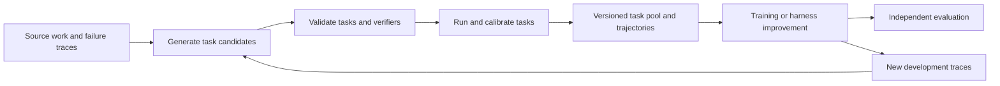

# Survey

This survey explains the technical choices behind tasks, environments, and feedback for AI agents. It supports the commercial exploration in [goals](00-goals.md). The [source register](../references/README.md) records review depth, and the [study notes](studies/README.md) examine individual references. Use the [glossary](glossary.md) for unfamiliar terms and [progress](progress.md) for completed work.

The central question is how to turn useful work into repeatable learning opportunities with trustworthy feedback. A task framework must support that process. Which parts should become our product depends on who needs them, what they can already do, and what improvement they will pay for.

## 1 From a language model to a working agent

A language model produces tokens, which are pieces of text or structured output. Its learned numerical parameters are called **weights**. During ordinary inference, those weights stay fixed. The input context can change, so the same model can behave differently after seeing a tool result or a written reminder.

An **agent** combines a model with software that lets it act. For example, a terminal agent reads a bug report, inspects files, runs tests, edits code, and checks the result. Its **harness** manages that interaction: tools, context, execution limits, retries, and stopping. ReAct is an early reference for interleaving reasoning and actions that obtain new observations. [ReAct](https://arxiv.org/abs/2210.03629)

Consider an illustrative task: recover a service after a failed configuration rollout. The agent can inspect logs, change configuration, and restart the service. The environment includes files and running processes. Its hidden state may include queued requests or an expired lease. The agent sees only what its tools expose. This distinction matters: a task can fail because required information is unavailable, even when the model reasons correctly.

| Term | Meaning in the service task |
| --- | --- |
| State | The full condition of the service and its environment |
| Observation | The logs, files, and tool responses available to the agent |
| Action | A command, tool call, or final submission |
| Policy | The model's rule for choosing actions from the available history |
| Episode | One attempt, from the initial state to success, failure, or a limit |
| Trajectory or rollout | The recorded actions and observations during that attempt |
| Reward | A numerical score used by training |
| Verifier | The procedure that checks the result |

Sutton and Barto provide the formal language for this interaction. A Markov decision process models state transitions and rewards; partial observability means the agent cannot see the complete state. A full derivation is unnecessary for the first framework prototype, but the distinction prevents us from confusing an incomplete observation with an impossible task. See the [foundation reading](../references/README.md#f01-rl-foundations).

## 2 What can improve and what training requires

**Post-training** means further training an already pretrained model to improve its behavior. Different methods consume different assets.

| Method | What changes | What it consumes |
| --- | --- | --- |
| Supervised fine-tuning, or SFT | Model weights | Examples of desired outputs or actions |
| Preference training, such as DPO | Model weights | Pairs of preferred and less-preferred responses |
| Online reinforcement learning, or RL | Model weights | Tasks, runnable environments, and reward functions; the trainer collects policy attempts and scores them |
| Memory or retrieval | Information supplied to the model | Notes, documents, past experiences |
| Harness improvement | The software around the model | Changes to tools, prompts, control flow, or context management |
| More inference-time search | Attempts and computation used to solve a task | Additional samples, feedback, and selection |

The RL row describes the online setting studied here. Its optimizer still consumes scored attempts, but a task supplier typically provides the work, execution environment, and checker. Other arrangements use recorded experience, including offline RL or SFT on successful trajectories.

In SFT, the training objective increases the likelihood of the supplied target behavior. The data can contain a full solution trajectory or a shorter target. A plausible demonstration is not automatically a good one: errors and unavailable information can also be imitated.

InstructGPT illustrates a pipeline combining demonstrations, preference comparisons, and RL from human feedback. A **reward model** predicts which outputs people prefer; RL then uses that learned score. This differs from directly checking an answer with tests. [InstructGPT](https://arxiv.org/abs/2203.02155)

**Direct Preference Optimization**, or DPO, trains from response comparisons without fitting a separate reward model and sampling new responses inside the usual RL fine-tuning loop. It still updates weights. It is a useful alternative when preference pairs are available but an interactive training loop is costly. [DPO, section 4](https://arxiv.org/html/2305.18290v3#S4)

In policy-gradient RL, the system samples attempts, scores them, and updates weights to favor actions associated with better rewards. A shell command or written reflection does not perform that update by itself. PPO is a foundational method that limits the incentive for overly large policy changes during optimization. [PPO](https://arxiv.org/abs/1707.06347)

**Group Relative Policy Optimization**, or GRPO, compares several outputs for the same problem. The original outcome-reward formulation subtracts the group's mean reward and divides by its standard deviation. This supplies an advantage: how much better or worse an attempt scored relative to the group, without a separate learned value model. [DeepSeekMath, section 4](https://arxiv.org/html/2402.03300v3#S4)

For example, rewards `[0, 0, 0, 1]` distinguish one successful attempt. Rewards `[0, 0, 0, 0]` do not. Equal nonzero rewards also provide no relative outcome signal. This does not mean no learning method can use such tasks; it means this signal cannot distinguish the sampled attempts. Difficulty and reward design therefore interact with the training method.

**RL with verifiable rewards**, or RLVR, uses a checker such as a test suite or answer comparison. It describes the reward source, not a single optimizer. DeepSeek-R1 is a useful case study of reasoning-oriented RL, supervised preparation, and distillation. Distillation trains a model using outputs from another model. Its different variants should not be reduced to a claim that RL always works without demonstrations. [DeepSeek-R1](https://arxiv.org/abs/2501.12948)

Finally, learning need not change weights. Reflexion records verbal feedback in memory for later attempts. That is operationally different from training a new checkpoint, even though its title uses reinforcement-learning language. [Reflexion](https://arxiv.org/abs/2303.11366)

### A worked training step

Imagine four attempts to repair the same service. A hidden check requires both restored availability and preserved acknowledged writes. This is an invented teaching example, not a run result.

| Attempt | What happened | Reward | Reward minus group mean |
| --- | --- | --- | --- |
| A | Restarted without fixing the configuration | 0 | −0.25 |
| B | Restored responses but lost writes | 0 | −0.25 |
| C | Changed an unrelated setting | 0 | −0.25 |
| D | Inspected the configuration, repaired it, and preserved writes | 1 | +0.75 |

The mean reward is 0.25. Subtracting it gives the advantages shown above. This simplified calculation matches the mean-centering idea used by AES; original GRPO also divides by the group's standard deviation. The optimizer uses those advantages with the probabilities of the model's generated tokens. It pushes up the likelihood of D's generated actions and down that of A–C's actions, subject to the method's update constraints.

In a common tool-agent setup, generated text and tool-call tokens participate in the training loss. Tool responses are observations supplied to the model and are masked out of that loss. The implementation must specify its exact token mask. A final task reward labels an entire attempt; it does not identify which individual command caused the failure. Useful commands inside a failed attempt may also receive negative pressure.

After the update, the weights have changed. New attempts may be more likely to follow behavior associated with D, but one update guarantees neither success on this task nor transfer to a new configuration failure. Both require fresh evaluation. If all four rewards were zero, the mean-centered advantages would all be zero and this outcome signal would provide no preference among them. The [training readings](01-study-plan.md#phase-3--how-tasks-become-training-inputs) cover the update mechanism and implementation references.

## 3 What a task framework must represent

A prompt alone rarely specifies an interactive task. The service-recovery example also needs a starting configuration, permitted tools, a completion rule, and a way to restore the initial state for another attempt.

| Component | Example | Design question |
| --- | --- | --- |
| Intent | Diagnose configuration faults while preserving data | Does the task exercise the capability we want to improve? |
| Instruction | Restore service without losing acknowledged writes | Is success clear without revealing the solution? |
| Initial state | Pinned code, faulty configuration, logs, request data | Can another worker reproduce it? |
| Action interface | Read files, edit config, run commands | Are required actions available and bounded? |
| Observation interface | Command output and permitted service metrics | Can the agent obtain enough evidence? |
| Termination | Submission, deadline, or resource limit | Are failure and timeout distinguished? |
| Isolation and monitoring | Allowed network destinations, scoped credentials, shared caches and services, trusted execution logs | Can agents cross task boundaries, alter grading evidence, or contact systems outside the task? |
| Verification | Recovery, data invariants, regression checks | Does the check measure the requested outcome? |
| Reference solution | A known way to restore the service | Is it one valid solution rather than the only accepted form? |
| Provenance | Parent task, source revision, generator, permissions | Can we trace origin, duplication, and allowed use? |

Gottlieb's task-design article makes intent explicit and argues that the prompt, environment, and verifier must agree with it. Our use of that framing is to record the target capability in author metadata, while deciding separately what the solver may see. The article is practical design guidance, not measured evidence of training benefit. [Task-factory study](studies/eli-gottlieb-reference.md)

Keep three assets distinct. A **task** gives the agent work to do. An **environment** provides the state and interfaces for doing it. A **trajectory** records one attempt. A dataset may contain any combination of them. A training buyer may need executable tasks for repeated sampling, while an SFT buyer needs suitable demonstrations.

Also distinguish three information roles. The author may see private construction evidence and the reference solution. The solver receives the task and permitted environment. The verifier receives what it needs to grade. Public development feedback and hidden evaluation checks need separate policies. Hiding everything can prevent useful debugging; revealing final answer keys can invalidate the measurement.

The documented OpenAI–Hugging Face incident shows why a container alone is not a complete boundary. Our [incident note](studies/eli-gottlieb-reference.md#a-documented-isolation-failure) links the investigation and its limits. State which resources each attempt may reach, who can write grading evidence, and which observations the trusted harness records. Test these permissions separately from whether the task is solvable.

Harbor already provides task, agent, sandbox, and verification concepts. It is an integration candidate. We should examine its interfaces before inventing a new package format. [Harbor documentation](https://docs.harborframework.com/)

## 4 Reward quality and learning value

A passing test shows that the checked conditions hold. The customer may need more than the test checks. A service could answer health checks while dropping writes. A patch could pass by disabling a test. A judge could reward confident wording rather than a correct explanation.

Rubric rewards extend evaluation to outputs that require several judgments. Rubrics as Rewards studies prompt-specific criteria and both explicit score aggregation and a judge's combined score. It supplies a training connection for our existing Q&A work. Its medical and scientific experiments do not establish the same benefit for codebase Q&A. [Rubrics as Rewards, sections 2–3](https://arxiv.org/html/2507.17746v2#S2)

Optimization makes reward defects especially important. An agent that is repeatedly rewarded for a shortcut may exploit it more often. Reward-overoptimization research demonstrates a gap between a proxy reward and a separate reference reward in a controlled synthetic setting. It motivates independent evaluation; it does not give a universal safe amount of optimization. [Reward overoptimization](https://arxiv.org/abs/2210.10760)

Our task-quality checks should answer several different questions:

- **Validity:** Is the task feasible, sufficiently specified, and correctly graded?
- **Difficulty:** How often does a named model and harness succeed under a stated budget?
- **Feedback:** Does an unsuccessful attempt reveal something useful, without exposing forbidden answers?
- **Diversity:** Do tasks exercise distinct skills and situations rather than repeat one template?
- **Transfer:** Does improvement carry to reserved tasks, repositories, or customer cases?
- **Economics:** Is the benefit worth generation, execution, grading, and human review costs?

These are our evaluation questions, not a claim that one score captures all six. In particular, low success can come from a broken environment, a wrong grader, or missing information. HUD's task-design guidance and AutoBenchmark's quality review both make this relevant distinction. [HUD](https://www.hud.ai/research/what-is-a-good-task), [AutoBenchmark](https://facebookresearch.github.io/RAM/blogs/autobench/)

## 5 Approaches to creating learning opportunities

### Repository tasks and static generation

SWE-bench evaluates agents on repository issues. SWE-smith constructs execution environments and synthesizes faults that break existing tests, then uses the resulting tasks and trajectories for training. They connect realistic software work to executable evaluation and scalable data construction. [SWE-bench](https://arxiv.org/abs/2310.06770), [SWE-smith](https://arxiv.org/abs/2504.21798)

For our exploration, static generation is an essential baseline. It can be simpler to reproduce and account for than a changing curriculum. We must test whether adapting tasks to a solver adds enough value to justify its extra inference and calibration costs.

### Environments adapted to the solver

AutoEnvScaling lets a proposer inspect solver experience, build and test environments, and revise tasks that fail admission or difficulty checks. Its shared-model setting trains both roles. Earlier work such as POET also pairs environment generation with solver improvement, though in a different setting. [AutoEnvScaling study](studies/autoenvscaling.md), [POET](https://arxiv.org/abs/1901.01753)

The important design question is the selection objective. Maximizing solver failure can generate impossible tasks. Maximizing admitted task count can generate duplicates or exploit admission checks. We need to assess relevance, diversity, and independent outcomes alongside the generator's immediate reward.

The [AES code findings](studies/autoenvscaling-code.md#3-confirmed-behavior-and-its-consequences) show why these judgments must survive the full data path. A framework should keep infrastructure failures separate from scored attempts, require enough valid evidence for a difficulty decision, and define what each training trace contains. Those requirements apply beyond AES.

### Improving the task-production process

Gottlieb distinguishes an inner loop that revises a task from an outer loop that changes how future tasks are produced. In his proposal, expert reviews become explicit criteria and revisions to authoring, grading, or routing. Cheaper review components may eventually replace expensive ones if they preserve judgment quality. This can change prompts and orchestration without updating model weights. [Task-factory study, PDF pages 4–7](studies/eli-gottlieb-reference.md)

Our hypothesis is that retaining expert decisions and their reasons could reduce repeated repair work. A test should compare the original and revised production processes on fresh tasks, using independent expert checks and counting all costs. Better production quality would still need a separate downstream test to establish training value. The post supplies this design direction, but no measured improvement or cost reduction.

### Reusing success and failure

Recursive Self-Rewrite collects successes under different harnesses. A planner and critic prepare guidance, then an executor solves the task again in a fresh environment. The verified trajectories train the model through SFT. Its results support studying trajectory reconstruction, but the comparison also changes data quantity. The main table alone does not isolate rewriting from additional training examples. On its long-horizon benchmark, improved process reward still accompanies zero completed tasks. The [study note](studies/recursive-self-rewrite.md) examines section 2 and table 5 of the supplied paper.

RLTL;DR uses verifier feedback to generate short insights for sequential attempts and trains the model to internalize those insights. Its ablations include SFT on task–insight pairs. The cost reduction there concerns policy updates; collecting trajectories still costs substantial computation. Generalization is also uneven: section 4 reports transfer on its API environments but overfitting on Leetcode. The [study note](studies/rl-tldr.md) examines sections 4–6 and table 2 of the supplied paper.

Together these suggest that training assets may include feedback, successful trajectories, and concise procedural guidance. They do not establish which asset a customer needs or which is cheapest to produce well.

### Stateful work and simulated users

ApprenticeBench studies a sequence of accounting tasks with historical records, feedback, and persistent memory. It asks whether an agent learns a job over time. This motivates evaluating state that persists across tasks, rather than assuming every task starts independently. [ApprenticeBench](https://neocognition.io/blog/apprentice-bench)

Impersona-Env uses a simulated user to produce feedback and preference pairs for DPO. Its author explicitly discusses the difficulty of evaluating a model against the same simulator used in training. Our implication is to test simulator fidelity and transfer to real users separately from simulator reward. [Impersona-Env](https://benshi34.github.io/#/blog/impersona-env)

### Different meanings of self-improvement

**Recursive self-improvement (RSI)** means repeated improvement in which earlier gains help produce later gains. The term does not identify a particular training algorithm. For each RSI claim, ask which component changes, what evidence selects a change, and whether repeated rounds improve reserved outcomes at a comparable cost. Model training, harness editing, memory accumulation, and task generation can be combined, but their contributions need separate tests.

Raven emphasizes orchestration and harness evolution. MiMo provides an integrated training example. TypeSafe explores structured decisions rather than general text generation. These broaden the comparison without determining our first implementation. In particular, a structured output guarantee is not a guarantee of a correct decision. [Raven](https://github.com/EverMind-AI/Raven), [MiMo release](https://mimo.mi.com/docs/en-US/news/latest/v2-6), [TypeSafe](https://typesafe.ai/blog/introducing-system-one-models-and-jev)

Harness² provides a concrete implementation comparison. An editor changes a fixed model's execution harness, probes alternatives on the current task, and retains harnesses and lessons for later editing. Its improvement loop excludes benchmark verdicts, but independent grading is still needed to measure success. The [study](studies/harness2.md) covers the two loops, execution costs, code boundaries, and our scripted offline demo. This broadens the potential consumers of our task framework beyond weight training.

## 6 Framework boundaries to investigate

The following is a candidate decomposition for experiments, not a committed architecture:

The final evaluation set stays outside the generation feedback loop. Development results can guide revisions, but repeatedly tuning against the final set would weaken its independence.

Systems work here includes environment reset, isolation, dependency pinning, failure classification, event recording, scheduling, and cost accounting. The AI-specific interfaces include model versions, reward semantics, sampling settings, and the information allowed in training examples.

Training systems add another concern: trajectories may be generated by an older policy while updates are already running. This is called **off-policy** data relative to the current policy. Mixing versions without recording them can make a training experiment hard to interpret. **On-policy** methods collect experience from the policy being optimized, with implementations controlling how stale samples may be.

Study adapters to an existing training system before building one. verl is an implementation of HybridFlow for language-model RL training. SkyRL is another candidate for the integration study. We have not selected or benchmarked either. [verl](https://verl.readthedocs.io/en/latest/), [SkyRL](https://docs.skyrl.ai/docs)

## 7 Reading results without misleading ourselves

With fixed model weights, sampled outputs can still vary. Tool timing and environment state may add variation. Repeating one task estimates consistency on that task; sampling different tasks addresses a different uncertainty, generalization to a wider workload. Keep both sources of variation visible.

**Pass@1** estimates success for one sampled attempt under a fixed setup. It is not necessarily the first recorded attempt. **Pass@k** measures whether at least one of k attempts succeeds. Averaging the success rates of five runs estimates single-attempt performance; it does not mean success within five attempts. A deployment also needs a way to select a correct result if it tries several. [Code evaluation paper](https://arxiv.org/abs/2107.03374)

**Best-of-k** includes that selection step. **Pass^k** asks whether all k attempts succeed, which is useful when repeated reliability matters. These metrics answer different questions. [Agent evaluation guide](https://www.anthropic.com/engineering/demystifying-evals-for-ai-agents)

Compare methods on the same tasks and analyze paired differences. Report what an error bar measures: run-to-run spread, uncertainty from task sampling, or another quantity. A difference smaller than one run's standard deviation is not, by itself, a test of statistical significance. [Statistical evaluation guide](https://www.anthropic.com/research/statistical-approach-to-model-evals)

Partial reward and full completion answer different questions. So do a relative percentage improvement and a percentage-point change. Keep the denominator and baseline next to the result.

Report model and harness versions, tools, context and time limits, environment resources, and retry budgets. A stronger harness or more search can raise scores with unchanged model weights. Equal training updates do not imply equal total cost. Include generation, rejected samples, calibration, and grading.

For generalization, reserve task families or repositories and keep related variants together. Evaluate both a focused capability and potential regressions. Protect the final evaluation from generator feedback and label leakage. String-overlap checks help identify copies, but semantic duplication and shared provenance also need attention.

The [research method](research-method.md) defines how to record these comparisons. Its purpose is to make a decision auditable, not to require a large experiment before every useful exploratory check.

## 8 From technical capability to a commercial project

A task generator can support several businesses: supplying training environments, validating rewards, or improving a customer's agent workflow. The buyer, integration, support burden, and acceptance test differ. Third Moment Research's public offering makes managed improvement a concrete comparison; the [business study](studies/third-moment-research.md) distinguishes public facts from our hypotheses.

Our systems background may help with realistic task construction, reproducibility, and efficient execution. Whether it creates a commercial advantage depends on access to valuable failures, trustworthy outcomes, and buyers. The [opportunity comparison](03-opportunities.md) owns those hypotheses.

Pinned implementation studies now cover selected paths in AutoEnvScaling and Harness². Further work should connect independently measured task quality to downstream improvement and compare commercial alternatives. Customer evidence and the [research experiment proposals](experiments.md) inform which technical components merit deeper implementation work; [progress](progress.md) records the current priorities.
