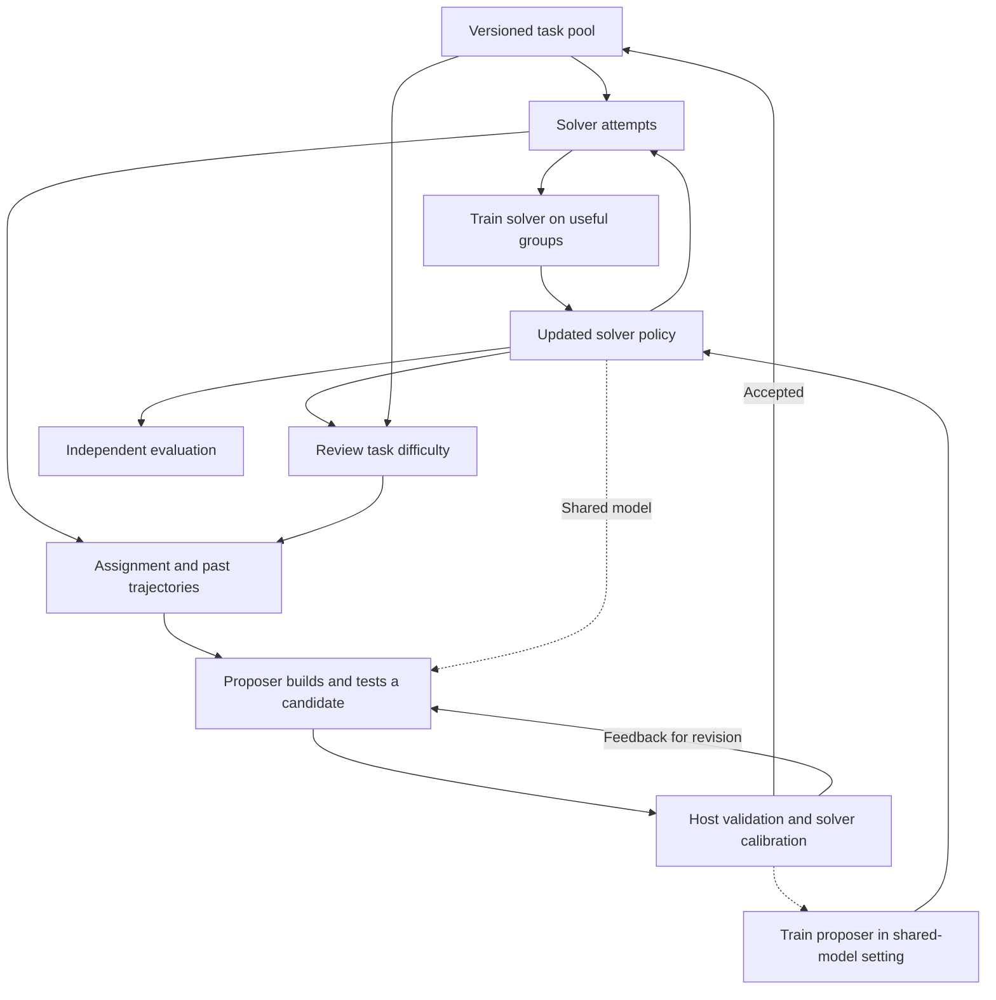

# AutoEnvScaling: how it works and what we should learn

AutoEnvScaling (AES) connects task construction to the failures of the model being trained. A coding agent builds executable tasks, a host checks them, and repeated solver attempts determine which tasks enter the training pool. The pool changes as the solver improves. For our team, the first opportunity to investigate is reliable task production and validation. Reproducing the full training system is a separate decision.

**Evidence as of 2026-10-14:** the supplied [v1 paper](../../references/papers/2610.14163v1-AutoEnvScaling.pdf), sections 3–4 and appendices G–H; selected code at commit `2b38259ac0ab5983c7de21df0f50696ab43e8869`; and the [recorded offline checks](../records/2026-10-14-autoenvscaling-code/README.md). Paper results remain author-reported. We have not run live generation, containers, model endpoints, or training. The [code study](autoenvscaling-code.md) provides pinned sources and findings; the [research record](../records/2026-10-14-autoenvscaling-code/README.md) makes our checks repeatable.

Use the [glossary](../glossary.md) for benchmark, trainer, GPU, and model-name conventions.

## 1. The system in familiar terms

There are three main actors. The **proposer** is a coding agent that authors tasks. The **solver** is an agent that attempts them. The **host** runs admission checks, manages the pool, and coordinates training. An agent combines a model with a **harness**: software that gives it tools, manages its conversation, and controls execution. A **rollout**, or trajectory, records one attempt, including actions, tool results, and its reward.

Think of the proposer as a worker submitting an executable test fixture. The host's admission service checks the submission. Solver attempts provide both training examples and evidence for the next assignment. The difference from a conventional test farm is that the solver's model weights can change, making previously useful tasks too easy.



The shared-model setting also trains the proposer from its checked submissions. With an external proposer, that weight-update path is absent. Evaluation tasks stay outside the generation loop; feeding their failures back to the proposer would make later scores less independent.

## 2. Follow one task through the code

Consider an illustrative task: repair a worker that processes a retried job twice. The instruction describes the required behavior, the container contains the faulty implementation, a private reference solution fixes it, and private tests check normal execution, retries, and crash recovery. This is our example, not a reported AES experiment.

**Assignment.** The host selects a parent task and summarizes recent solver attempts. The preview extracts recurring failed test names and chooses a harder or simpler direction using the fraction of attempts that fully passed, unless the pool-removal verdict overrides that direction. It also supplies aggregate rewards. This is a heuristic summary, not a demonstrated diagnosis of the model's underlying weakness. Repeated failures in crash recovery could guide the proposer toward a related recovery task.

**Construction.** The proposer receives past environments, solver traces, fixed instructions, and editable `memory/` and `tools/` directories. It can write files, execute commands, inspect failures, and revise its work. Its output is a Harbor package:

```text
task.toml                 task and runtime configuration
instruction.md            solver-visible request
environment/Dockerfile    executable starting environment
solution/solve.sh          private reference solution
tests/test.sh             private verifier entry point
```

The reference solution and verifier are separate from the solver's starting view. The proposer sees these authoring artifacts. See the [workspace and task code](autoenvscaling-code.md#1-code-map).

**Validation.** The host parses the package, runs the reference and empty agents, checks instruction overlap with held-out tasks, and requests a model-based rubric review. The environment build happens through the execution checks. A task must get full reference reward and less than 0.5 reward for doing nothing. The overlap check searches for matching sequences of 13 words; it does not establish semantic independence. The rubric reviewer defaults to the proposer's own model, so correlated mistakes remain possible.

**Calibration.** The current solver attempts a valid task. The default starts with four attempts and adds attempts up to eight when the mean reward is within 0.15 of either band edge. Acceptance requires mean reward in [0.25, 0.75] and population standard deviation at least 0.1. Below-band tasks may get one extra attempt with reference-solution hints to guide revision; that attempt is excluded from calibration rewards. An initial attempt can have up to two revisions, each checked again. These are paper settings, not universal requirements.

**Pool management.** Accepted tasks fill the active pool; overflow goes to a reserve. Periodic review retires tasks that become too easy, too hard, or produce constant rewards, and promotes suitable reserve tasks. Replacement requests guide further generation. The preview's pool review uses four attempts, rather than admission's adaptive four-to-eight rule. Seed tasks bypass full admission, so the seed pool is a trusted input. See the [pool walkthrough](autoenvscaling-code.md#4-pool-and-training-boundaries).

Task identity, one execution attempt, calibration against a particular solver, and pool membership are different records. A task useful for today's solver may be unsuitable for tomorrow's solver without any change to its files.

## 3. Why training needs varying rewards

A **policy** is the model's rule for choosing its next output. Updating weights changes that rule. The paper uses two settings:

| Setting | What changes |
| --- | --- |
| External proposer | The solver's weights are trained. The proposer's weights stay fixed; editable tools and memory can change its behavior. |
| Shared model | One model serves both roles. Training uses solver and proposer attempts, with separate reward groups. |

The paper defines solver reward as the fraction of tests passed; the preview instead trusts the submitted verifier to implement that meaning. The proposer receives -1 for invalid tasks, -0.25 for valid tasks that fail calibration, and +1 for admission. This rewards usable training tasks rather than merely making the solver fail.

Training compares attempts within a group. For solver rewards `[0, 0.5, 1, 1]`, the mean is 0.625. Subtracting it gives **advantages** `[-0.625, -0.125, 0.375, 0.375]`: a signal to favor outputs associated with better attempts and reduce those associated with worse attempts. AES groups solver attempts by environment and proposer attempts by assignment. It drops constant-reward groups because this calculation gives them no learning signal.

AES uses Divergence Proximal Policy Optimization (DPPO), which constrains updates as the policy changes. Its advantages are mean-centered without GRPO's division by standard deviation. The shared-model run first uses supervised fine-tuning on 600 successful proposer trajectories from external models. Later self-training therefore does not establish independence from external demonstrations at initialization. Sources: section 3.3 and appendices G.1 and H.

A reward of 0.75 is not a 75% full-task success rate. Four attempts that each pass three of four checks have mean reward 0.75, full-task success rate zero, and no reward variation. The preview uses full success rate for assignment direction and mean reward for calibration. Our framework must name these measures explicitly.

## 4. What the results establish

**What is Tmax?** [Tmax](https://arxiv.org/abs/2606.23321) is an open recipe for terminal-agent data and training. Its generation recipe varies task categories, difficulty, personas, and verifiers. In AES's paper comparison, the same proposer generates a fixed Tmax pool before solver training; AES adapts its pool during training. The release substitutes existing TMax-15K tasks, as the [code study](autoenvscaling-code.md#5-what-the-release-does-not-establish) explains.

These Terminal-Bench results use **avg@5**, average performance across five attempts, not pass@5, which asks whether any attempt succeeds. Comparisons use the paper's Pi harness and evaluation resources.

| Comparison | Author-reported result | Limit |
| --- | --- | --- |
| Qwen3.5-35B-A3B, GPT-5.6-sol proposer, TB2.1 | Static Tmax 34.6 ± 1.9; AES 38.9 ± 2.4 | Table 3: 4.3 percentage points at matched solver updates; ± denotes confidence intervals. |
| Same setting, past solver feedback removed | 35.3 ± 2.3 | Supports studying trace access; see the [precise ablation definition](autoenvscaling-code.md#removing-solver-feedback-does-not-remove-all-solver-information). |
| Qwen3.5-35B-A3B, Claude Opus 5 proposer, TB2.1 | Static Tmax 35.5 ± 1.6; AES 39.3 ± 1.6; without solver trajectories 32.6 ± 1.7 | Table 3: without traces, the adaptive pipeline is 2.9 points below static Tmax. Trace value must be tested rather than assumed. |
| Shared Qwen3.6-35B-A3B, TB2.1 | Cold-start checkpoint 41.1; AES ends at 53.3; static Tmax at 47.2 | Figure 6: 6.1 points over the static comparison. |
| Shared model, TB4.0 | Start 1.6; AES 3.2; static Tmax 1.4 | Transfer to a harder evaluation, with low absolute success. |

The abstract's 12.2-point shared-model gain is over the starting checkpoint; the controlled difference from static Tmax is 6.1 points. TB2.1 contains 89 tasks. Table 3 calls its ± values confidence intervals but does not explain their construction or report variation across repeated training runs. Evaluation sampling and training-run variation are separate uncertainties. Appendix H's cold-start comparison reports a 1.1-point change with a 95% bootstrap interval of [-4.9, 7.4]; that is a different comparison and cannot supply an interval for Table 3.

Three additional results matter for product and systems decisions:

| Result | Setting and evidence | What to learn |
| --- | --- | --- |
| Cost of generating technically valid tasks | Table 2: AES costs US$0.01–2.75 per valid environment across eight proposers. It is cheaper than plain prompting for six, but more expensive for Claude Opus 5 and GPT-6-astra. | Here valid means build, reference, and empty-agent checks pass. This is not cost per independently audited, buyer-useful task or an end-to-end training cost. |
| Rollout collection efficiency | Figure 7 and appendix G.1: shared Qwen3.6-35B-A3B retains useful groups at 3.1× the static baseline's rate and collects each update's rollouts 42% faster on average. Hardware and rollout concurrency match over updates 0–162. | Selection of tasks can save solver work. This measures collection time, not total run time including generation and review. |
| Learning to ask for missing information | Section 4.5, Table 5: after the same 75-trajectory cold start, Qwen3.6-35B-A3B reaches 6.8% held-out HiL-Bench task success with 100 official training tasks, versus 33.9% with 500 generated tasks. | A buyer-relevant behavior, but task quantity changes fivefold. The comparison does not isolate generation quality at equal data volume. |

Matched solver updates do **not** match total compute or elapsed time. Generation, calibration, review, and discarded attempts add work. Full AES and static runs reach 288 solver updates. The no-proposer-training ablation ends at 160; at that common endpoint, their TB2.1 scores are 48.9, 44.9, and 40.1 respectively. Comparing unequal endpoints would overstate the isolated effect. Source: appendix G.1.

The shared-model run uses 4–8 B200 GPUs, 16 environment groups of 16 trajectories per solver batch, and a 256-task pool reviewed every 16 solver updates. Released tables and plotting data do not include the original task suites, trajectories, or checkpoints needed for independent reproduction. The preview also differs from the paper in some checks and training paths. See the [release comparison](autoenvscaling-code.md#5-what-the-release-does-not-establish).

## 5. What we should take into our framework

These are candidate requirements, not a decision to build a general platform.

| Requirement | Why it matters | Smallest useful implementation |
| --- | --- | --- |
| Version the whole task | Instructions, environment, reference solution, and verifier jointly define the outcome. | Immutable artifact digest plus parent and split metadata; reuse Harbor packaging initially. |
| Keep execution failure separate from task failure | A failed sandbox tells us nothing about the proposed solution. | Carry the reason and any usable score through collection, review, and training; see the [failure analysis](autoenvscaling-code.md#failure-classification-and-pool-review-need-one-shared-policy). |
| Audit the verifier independently | The author can make matching mistakes in the solution and tests. | Valid alternative solutions, plausible wrong solutions, repeated resets, and expert samples. |
| Make calibration conditional on the solver | Difficulty depends on weights, harness, sampling, and resources. Small samples are noisy. | Store versions, valid attempt counts, raw rewards, and uncertainty; allow an inconclusive verdict. |
| Keep lineage and cost | Accepted task count hides retries, rejections, duplicates, and human repair. | Candidate-to-attempt-to-admission records with usage and exclusion reasons. |
| Define persistence and training contracts | Shared memory needs a selection rule. A training trajectory needs more than a readable transcript. | Version memory changes; record policy versions, token IDs, sampling probabilities, and loss masks when required by the trainer. |

The [code study](autoenvscaling-code.md#3-confirmed-behavior-and-its-consequences) owns the implementation findings on failure handling, calibration, memory, and isolation. They inform the requirements above; they do not commit us to repairing or adopting AES.

Commercially, measure the cost of an independently accepted, relevant task and the improvement it enables for a buyer. Internal admission count is insufficient. Our systems skills may help with execution, evidence, and verifier debugging. Whether customers value that enough to support a product remains an open hypothesis in the [opportunity comparison](../03-opportunities.md).

## 6. What remains unclear

- **Validity:** How often do admitted tasks reward shortcuts, reject valid alternatives, or rely on ambiguous instructions?
- **Calibration:** How stable are four-to-eight-attempt decisions on fresh attempts, and how much reward variation comes from flaky execution?
- **Transfer:** Are generated tasks useful beyond the solver and harness that calibrated them? Do they cover new families or mostly variants of known parents?
- **Causal contribution:** How much gain comes from traces, task replacement, proposer weight updates, and editable memory separately?
- **Execution fidelity:** Which release path reproduces the reported training behavior? Bridge and carry implementations have materially different batch and trajectory semantics.
- **Economics:** Does improvement survive a comparison that counts all inference, environment, review, and training costs? Which buyer owns this cost today?

## 7. What to test next

These are AES-related experiment candidates. The [study plan](../01-study-plan.md) and [progress](../progress.md) set the project order: market comparison and practical foundations first. Repair AES only if a selected experiment will reuse its code. Paid or training experiments need a concrete resource cap.

| Step | Test and controls | Output and decision |
| --- | --- | --- |
| 1. If reusing AES, check result handling | Cover infrastructure failure through export, insufficient valid attempts, duplicate artifacts, reset repeatability, and conflicting memory updates. Start with synthetic inputs and one hand-built task. | Explicit invariants and failing examples. Resolve the export defect and define minimum scored attempts before training on this output. |
| 2. Audit task quality | Apply [E1](../01-study-plan.md#e1-verify-the-verifier) to roughly 10–20 systems tasks. Test valid alternatives, meaningful mistakes, and shortcuts with independent expert judgments. | Defect types, false acceptance/rejection, repair work, and cost. Establish whether the verifier is usable. |
| 3. Measure calibration stability | Fix solver and harness. Compare four/eight-attempt decisions with a larger fresh sample. Retain infrastructure failures separately; repeat across task families. | Decision disagreement and uncertainty versus cost. Choose thresholds from observed data. |
| 4. Isolate trace value | Apply [E2](../01-study-plan.md#e2-generate-from-solver-failures): same parents, aggregate statistics, proposer, checks, and budget; vary raw traces and failure summaries. Count rejected work. | Independent quality, failure coverage, diversity, and cost per accepted task. Use a separate arm to remove all solver information. |
| 5. Check transfer and commercial relevance | Try a reserved solver or harness and a buyer-relevant workflow. If justified, design bounded training against a static pool at matched total budget. | Evidence of transfer and delivery economics. Decide whether to pursue task supply, validation, or managed improvement. |

The first four candidates study task production without updating weights. Test demand and downstream improvement separately.

Before extending AES, compare its baseline and at least one other generator. AES Table 1 and section 2 identify Tmax (prompt-based generation), RST and Environment Evolution (revision with execution feedback), SETA and AutoData (agent-based authoring), and SPADE (a shared proposer/solver model). Other leads include Endless Terminals, TermiGen, Terminal-World, Terminal-Universe, T1, SWE-Universe, CalibForge, Envs-FORGE, EnvHarness, Gym-Anything, Agent World Model, and ScaleEnv. This is a discovery list from AES, not our review of those systems. Start with Tmax because it defines the baseline; choose the next source by the question our experiment needs to answer.
