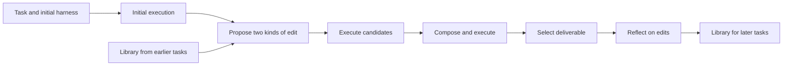

# Harness²: improving the software around a fixed model

Harness² changes how an agent executes tasks and how later edits use earlier experience. It does not train model weights or generate a new task curriculum. For our team, it is a concrete comparison with AutoEnvScaling: the same task and trace infrastructure might support either training or improvement of the software around a model.

**Review scope, 2026-10-19–20:** selected paper methods and results, selected implementation paths, and the provided deterministic offline demo. The [second review resolution](../reviews/claude-init-review-2-resolution.md) records corrections and further source checks. Code observations below refer to [commit `1cfe254`](https://github.com/google-research/harness2/tree/1cfe254e8d25b15f37048c3730134686abe60335). We have not reproduced the benchmark results or run its live model integrations. Bibliographic details are in the [source register](../../references/README.md#harness2).

## How it works

There are two roles. The **executor** attempts the user's task. The **editor** examines the task, execution traces, and produced files, then changes the executor's harness. Editable files can contain instructions, tool guidance, memory, skills, or executable scripts. Both roles use fixed model weights.

The scheduler and recursion code divide the work as follows:

1. Run the task with the initial harness. This is a comparison run, not a known-correct solution. [`run_task`](https://github.com/google-research/harness2/blob/1cfe254e8d25b15f37048c3730134686abe60335/harness2/core/schedule.py#L566) calls [`_roll_bases`](https://github.com/google-research/harness2/blob/1cfe254e8d25b15f37048c3730134686abe60335/harness2/core/schedule.py#L430).
2. Propose general execution improvements and domain-specific improvements from the initial traces. [`run_parallel`](https://github.com/google-research/harness2/blob/1cfe254e8d25b15f37048c3730134686abe60335/harness2/core/recursion.py#L343) orchestrates these candidates.
3. Execute each candidate on the same task to collect new traces and deliverables. This is also in `run_parallel`.
4. Ask a composer to combine, revise, or retain changes using the observed differences, then execute its harness. `run_parallel` implements this composition; [`run_sequential`](https://github.com/google-research/harness2/blob/1cfe254e8d25b15f37048c3730134686abe60335/harness2/core/recursion.py#L452) instead chains refinement steps.
5. Return a final deliverable through [`_run_one_mode`](https://github.com/google-research/harness2/blob/1cfe254e8d25b15f37048c3730134686abe60335/harness2/core/schedule.py#L480). With several final candidates, `run_selection` compares anonymized outputs and selects an existing answer. At `k=1`, `trivial_selection` uses the single final if it is usable.
6. [`reflect_adoption`](https://github.com/google-research/harness2/blob/1cfe254e8d25b15f37048c3730134686abe60335/harness2/core/selection.py#L402) asks for lessons from the edits. `_run_one_mode` passes qualifying experience and the adopted harness to the library for later tasks.

The distinction between the loops matters. Within a task, the system revises an execution harness. Across tasks, it accumulates examples and lessons that guide future editing. Each new task starts from the common initial harness; it does not automatically inherit the preceding task's final harness. The [scheduler](https://github.com/google-research/harness2/blob/1cfe254e8d25b15f37048c3730134686abe60335/harness2/core/schedule.py#L480) connects execution, selection, reflection, and the library.

For example, a systems agent might repeatedly restart a service without checking whether writes were preserved. An editor could add a verification script and a rule to run it before submission. A stored lesson could explain when that check is relevant. This is our illustrative application, not a result reported by Harness².

## What “without verifier feedback” means

The editing loop uses task materials, traces, and deliverables. It excludes the benchmark's hidden grading verdicts. It still makes judgments about whether an edit helped; those judgments can be wrong. Independent grading remains necessary to measure actual improvement.

The code enforces allowed harness structure and checks for certain leaked paths and verdict markers. It does not prove that an edited script is correct or that a lesson transfers. In particular, [library admission](https://github.com/google-research/harness2/blob/1cfe254e8d25b15f37048c3730134686abe60335/harness2/core/library.py#L43) requires nonempty cue, lesson, and evidence fields. Its content check scans harness paths/text and experience text for [seven fixed grader-verdict strings](https://github.com/google-research/harness2/blob/1cfe254e8d25b15f37048c3730134686abe60335/harness2/core/context.py#L419), such as `"passed_count"`. This can detect specific leaks, but cannot establish that other answer leakage is absent or that a lesson is true.

## Execution and cost

The [budget ledger](https://github.com/google-research/harness2/blob/1cfe254e8d25b15f37048c3730134686abe60335/harness2/core/ledger.py#L26) counts `4k` executor runs and `3k` editing stages for either recursion mode:

- Parallel mode uses `k` initial runs, `2k` candidate runs, and `k` composed final runs. Increasing `k` widens the search.
- Sequential mode starts with `k` initial runs and performs `k` successive edit-and-compose steps. Increasing `k` deepens refinement.

Selection, reflection, and retries require additional accounting. One executor run may itself contain many model calls. At `k=1`, there are four executor runs per task and no selector session; both modes use the basic improvement step. This is more work than a single ordinary task attempt.

## Reported results and alternatives

The [paper, tables 1–2 and appendix B](https://arxiv.org/html/2610.14224v1), evaluates GLM-5 and Gemini 3.5 Flash under both OpenCode and Codex. The following gains compare `k=1` Harness² with each unchanged base harness, using Claude Opus 4.8 as editor. Values in the paper are means over three runs with shuffled task order; their reported standard deviations are not confidence intervals.

| Benchmark and metric | Evaluation set | Gain across the four configurations |
| --- | --- | --- |
| WorkBuddy-Bench, macro-average score over Code/Web/Office | 100 test tasks | +3.0 to +11.5 score points |
| JobBench, weighted rubric score | 34 test tasks | +1.2 to +4.5 score points |
| LAB, fraction of grading criteria passed | 100 legal test tasks | +2.0 to +11.8 percentage points |

The earlier headline examples were the largest WorkBuddy and JobBench gains: GLM-5/OpenCode rises from 64.2 ± 1.4 to 75.7 ± 2.2 on WorkBuddy; Gemini/OpenCode rises from 31.5 ± 1.1 to 36.0 ± 2.3 on JobBench. Smaller gains matter too. On JobBench under Codex, Gemini rises from 33.9 ± 2.6 to 35.3 ± 3.5, while GLM-5 rises from 23.6 ± 2.3 to 24.8 ± 0.2. The improvements are small relative to some run standard deviations. Those summaries alone cannot determine the uncertainty of a paired difference or its statistical significance.

### Offline tuning and retries

**Meta-Harness** searches for a harness on separate training/development tasks, then deploys it unchanged. On JobBench with Gemini/OpenCode, it scores 35.8 ± 1.0 versus Harness²'s 36.0 ± 2.3. On LAB with Gemini/Codex, Meta-Harness scores 76.5 ± 2.1 versus 75.6 ± 4.5 for Harness². These are paper-reported comparisons under the same evaluation protocol, not our reproduction. They motivate testing whether ongoing editing is worth its additional deployment work.

Figure 5 already includes **best-of-k**: independent runs of the unchanged harness, with the same selector choosing a deliverable without grading scores. Harness² compares favorably in the plotted WorkBuddy Code/Office settings. However, the same `k` is not the same compute: best-of-k has `k` executor runs, while Harness² has `4k` plus editing. A new experiment should address our task family and cost boundary, rather than treat retries as an unstudied alternative.

Figure 6 plots one **combined token total per task**, including execution and improvement before final submission. It does not split executor from editor tokens. Under its reported accounting, no plotted alternative achieves both greater gains and lower total token use than either Harness² configuration. Meta-Harness uses more compute than Harness² at `k=5` in this comparison. Offline tuning is therefore not established as cheaper. Our comparison must state how search cost is amortized over deployment volume, and include dollars, latency, and reflection after submission.

### Library evidence and evaluation limits

Table 3 holds Gemini/OpenCode and `k=1` fixed. Removing the library changes WorkBuddy from 77.5 to 74.4 and JobBench from 36.0 to 34.2. This supports the library's value in that setup. It does not establish an additive fraction of improvement that will persist across models or workloads; components may interact. Figure 7's JobBench-library transfer adds 0.6, 0.5, and 2.9 points on WorkBuddy Code, Web, and Office respectively over the one-step method without that transferred experience.

Appendix B uses Claude Opus 4.8 to grade JobBench, also the editor/selector model. Hiding the rubric separates information access, but does not remove shared model biases; appendix F acknowledges that broader risk. Independent expert checks or a different judge are useful tests.

The code also supplies hand-written benchmark guidance and selection checks, for example [JobBench's prompt profile](https://github.com/google-research/harness2/blob/1cfe254e8d25b15f37048c3730134686abe60335/harness2/benchmarks/jobbench.py#L94). This is human setup work a deployment must account for. Its contribution is not isolated by the cited ablations, so we cannot assign a share of the gains to it. None of these results establishes customer demand.

## Code findings that affect our framework

| Inspected boundary | Observation | What we should learn |
| --- | --- | --- |
| [Benchmark adapter](https://github.com/google-research/harness2/blob/1cfe254e8d25b15f37048c3730134686abe60335/harness2/core/spec.py#L201) | Supplies tasks, source files, execution, traces, deliverables, harness validation, and separate scoring. | A task contract can serve several improvement methods. Keep execution evidence and evaluation separable. |
| [Final selection](https://github.com/google-research/harness2/blob/1cfe254e8d25b15f37048c3730134686abe60335/harness2/core/selection.py#L93) | The final pool excludes initial-run outputs. Preserving the initial harness during composition is different from returning an already produced initial answer. | Test regression and the value of allowing an unchanged-output fallback. Adoption does not establish superiority. |
| [Library storage](https://github.com/google-research/harness2/blob/1cfe254e8d25b15f37048c3730134686abe60335/harness2/core/library.py#L58) | Stores complete harnesses and structured experience within a domain and run configuration. | Version persistent state, preserve provenance, and make reset/retention policy part of evaluation. |
| [Context construction](https://github.com/google-research/harness2/blob/1cfe254e8d25b15f37048c3730134686abe60335/harness2/core/context.py#L191) | Filters source files and checks specified leak patterns. | Test the whole information boundary, including network access, rather than relying on filename checks alone. |

At `k=1`, [`trivial_selection`](https://github.com/google-research/harness2/blob/1cfe254e8d25b15f37048c3730134686abe60335/harness2/core/selection.py#L360) filters out failed or missing final deliverables. If none remains, it returns a selection error even if an initial run produced an answer. There is no initial-output fallback. A deployment should explicitly choose whether to return a checked earlier result or report failure; returning an unchecked earlier answer is not automatically safe.

The release's [experiment guide](https://github.com/google-research/harness2/blob/1cfe254e8d25b15f37048c3730134686abe60335/docs/EXPERIMENTS.md?plain=1#L93) reports that a JobBench validation run retrieved its public rubric over the network. That is an author-reported release observation; we did not reproduce it, and it does not establish contamination of the paper's runs. The guide states that executor networking is unrestricted. The [Codex adapter](https://github.com/google-research/harness2/blob/1cfe254e8d25b15f37048c3730134686abe60335/harness2/substrate/codex.py#L166) disables its tool sandbox. A live pilot therefore needs an independently enforced execution boundary. Editable files called “guardrails” contain agent guidance, not that boundary.

## What we observed locally

The provided demo completed two accounting tasks in both modes at `k=1`. Its initial script incorrectly sums only positive amounts. A scripted editor removes that filter. On the first ledger, the total changes from `105.25` to the correct `85.15`; the next task starts with one earlier library entry per mode.

This exercises real local scripts, recursion, reflection, and persistence. It does not show an AI discovering a repair, using the library intelligently, or generalizing. The [durable record](../records/2026-10-19-harness2-demo/README.md) contains the command, observed outputs, and exact limits. No model API or benchmark judge was used.

## Implications and next tests

Our inference is that trustworthy tasks, resets, traces, and independent graders could support both AES-style training and Harness²-style editing. Harness² additionally makes persistent improvement state an evaluation input. A framework that records only model version and task version would miss an important source of variation.

### First comparison: where should improvement work happen?

Use the same executor, task family, and independent evaluation. Compare four arms: unchanged-harness best-of-k with a selector; a manually tuned harness; a harness found by offline search and frozen before evaluation; and Harness² editing during each task. Use the same selector and editor models where the roles apply. The manual arm needs separate human-effort accounting.

Set common total token caps and report actual usage, including selection, edits, rejected candidates, retries, reflection, and evaluation. Do not force a method to waste unused budget. Charge offline search to a declared deployment volume and show how the answer changes with that volume. Report dollars and latency as well, since tokens from different models have different costs. Figure 5 informs the retry arm; figure 6 informs cost accounting. Proceed only if the observed outcome and cost meet a defined customer need.

### Further checks if this opportunity remains promising

- **Library transfer:** compare library disabled/enabled with fixed editor and task order. Freeze development libraries for evaluation on reserved families; test online accumulation separately using only earlier tasks. Inspect incorrect lessons and regressions.
- **Failed or harmful edits:** inject an unusable composed run after a successful initial run. Compare explicit failure with an independently checked initial-output fallback. Also measure cases where a usable final is worse than the initial answer.
- **Information boundary:** use private local fixtures, independent grading, and synthetic leakage probes. Record network permissions and verify that grader failures remain unscored.
- **Task contract:** adapt one familiar task through the existing benchmark interface. Verify reset, deliverable extraction, trace completeness, and separate scoring before considering a new framework.

These are candidate experiments, not an expansion of the active worklist. Start with the [learning path](foundations.md) and H1/E1. A buyer who needs weight-training data and a buyer who needs better deployed agent behavior may require different deliverables. Harness² gives us a concrete alternative to compare; it does not select our product.
