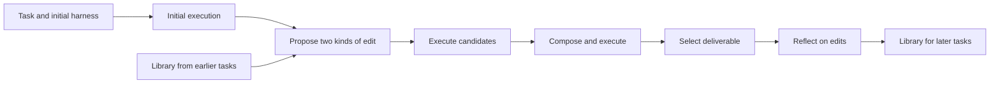

# Harness²: improving the software around a fixed model

Harness² changes how an agent executes tasks and how later edits use earlier experience. It does not train model weights or generate a new task curriculum. For our team, it is a concrete comparison with AutoEnvScaling: the same task and trace infrastructure might support either training or improvement of the software around a model.

**Review scope, 2026-10-19:** selected paper methods and results, selected implementation paths, and the provided deterministic offline demo. Code observations below refer to [commit `1cfe254`](https://github.com/google-research/harness2/tree/1cfe254e8d25b15f37048c3730134686abe60335). We have not reproduced the benchmark results or run its live model integrations. Bibliographic details are in the [source register](../../references/README.md#harness2).

## How it works

There are two roles. The **executor** attempts the user's task. The **editor** examines the task, execution traces, and produced files, then changes the executor's harness. Editable files can contain instructions, tool guidance, memory, skills, or executable scripts. Both roles use fixed model weights.

The inspected [recursion code](https://github.com/google-research/harness2/blob/1cfe254e8d25b15f37048c3730134686abe60335/harness2/core/recursion.py#L343) implements this basic step:

1. Run the task with the initial harness. This is a comparison run, not a known-correct solution.
2. Ask one editor for general execution improvements and another for domain-specific improvements. Both receive evidence from the initial run.
3. Execute each candidate harness on the same task to obtain new traces and deliverables.
4. Ask a composer to combine, revise, or retain changes using those observed differences. Execute the resulting harness.
5. Return a final deliverable. When several final candidates exist, a selector compares anonymized outputs against the request and source material. It selects an existing output rather than writing another answer.
6. Reflect on the edits and store the adopted harness with a lesson, conditions for using it, and supporting evidence. Later tasks can consult that library.

The distinction between the loops matters. Within a task, the system revises an execution harness. Across tasks, it accumulates examples and lessons that guide future editing. Each new task starts from the common initial harness; it does not automatically inherit the preceding task's final harness. The [scheduler](https://github.com/google-research/harness2/blob/1cfe254e8d25b15f37048c3730134686abe60335/harness2/core/schedule.py#L480) connects execution, selection, reflection, and the library.

For example, a systems agent might repeatedly restart a service without checking whether writes were preserved. An editor could add a verification script and a rule to run it before submission. A stored lesson could explain when that check is relevant. This is our illustrative application, not a result reported by Harness².

## What “without verifier feedback” means

The editing loop uses task materials, traces, and deliverables. It excludes the benchmark's hidden grading verdicts. It still makes judgments about whether an edit helped; those judgments can be wrong. Independent grading remains necessary to measure actual improvement.

The code enforces allowed harness structure and checks for certain leaked paths and verdict markers. It does not prove that an edited script is correct or that a lesson transfers. In particular, [library admission](https://github.com/google-research/harness2/blob/1cfe254e8d25b15f37048c3730134686abe60335/harness2/core/library.py#L43) requires populated experience fields and additional content checks. A populated “evidence” field is not independent validation of its claim.

## Execution and cost

The [budget ledger](https://github.com/google-research/harness2/blob/1cfe254e8d25b15f37048c3730134686abe60335/harness2/core/ledger.py#L26) counts `4k` executor runs and `3k` editing stages for either recursion mode:

- Parallel mode uses `k` initial runs, `2k` candidate runs, and `k` composed final runs. Increasing `k` widens the search.
- Sequential mode starts with `k` initial runs and performs `k` successive edit-and-compose steps. Increasing `k` deepens refinement.

Selection, reflection, and retries require additional accounting. One executor run may itself contain many model calls. At `k=1`, there are four executor runs per task and no selector session; both modes use the basic improvement step. This is more work than a single ordinary task attempt.

## Reported results and their limits

The [paper, tables 1–2 and appendix B](https://arxiv.org/html/2610.14224v1), reports these examples against unchanged base harnesses. Both use OpenCode, `k=1`, and Claude Opus 4.8 as editor.

| Executor and evaluation | Base | Harness² |
| --- | --- | --- |
| GLM-5; WorkBuddy-Bench, three-domain macro-average score, 100 test tasks | 64.2 ± 1.4 | 75.7 ± 2.2 |
| Gemini 3.5 Flash; JobBench score, 34 test tasks | 31.5 ± 1.1 | 36.0 ± 2.3 |

Values are means ± standard deviations over three runs with shuffled task order, not confidence intervals. Table 3 tests library removal separately. The paper's executor-step counts omit editing work; figure 6 separately counts executor and improvement tokens before submission. Our commercial comparison still needs dollars, latency, and post-submission reflection costs. These are reported benchmark gains, not our reproduction or evidence of customer demand.

## Code findings that affect our framework

| Inspected boundary | Observation | What we should learn |
| --- | --- | --- |
| [Benchmark adapter](https://github.com/google-research/harness2/blob/1cfe254e8d25b15f37048c3730134686abe60335/harness2/core/spec.py#L201) | Supplies tasks, source files, execution, traces, deliverables, harness validation, and separate scoring. | A task contract can serve several improvement methods. Keep execution evidence and evaluation separable. |
| [Final selection](https://github.com/google-research/harness2/blob/1cfe254e8d25b15f37048c3730134686abe60335/harness2/core/selection.py#L93) | The candidate pool excludes initial-run outputs. The composer can preserve the initial harness, but the selector cannot simply return its original output. | Test regression and the value of allowing an unchanged-output fallback. Adoption does not establish superiority. |
| [Library storage](https://github.com/google-research/harness2/blob/1cfe254e8d25b15f37048c3730134686abe60335/harness2/core/library.py#L58) | Stores complete harnesses and structured experience within a domain and run configuration. | Version persistent state, preserve provenance, and make reset/retention policy part of evaluation. |
| [Context construction](https://github.com/google-research/harness2/blob/1cfe254e8d25b15f37048c3730134686abe60335/harness2/core/context.py#L191) | Filters source files and checks specified leak patterns. | Test the whole information boundary, including network access, rather than relying on filename checks alone. |

The release's [experiment guide](https://github.com/google-research/harness2/blob/1cfe254e8d25b15f37048c3730134686abe60335/docs/EXPERIMENTS.md#L93) reports that a JobBench validation run retrieved its public rubric over the network. That is an author-reported release observation; we did not reproduce it, and it does not establish contamination of the paper's runs. The guide states that executor networking is unrestricted. The [Codex adapter](https://github.com/google-research/harness2/blob/1cfe254e8d25b15f37048c3730134686abe60335/harness2/substrate/codex.py#L166) disables its tool sandbox. A live pilot therefore needs an independently enforced execution boundary. Editable files called “guardrails” contain agent guidance, not that boundary.

## What we observed locally

The provided demo completed two accounting tasks in both modes at `k=1`. Its initial script incorrectly sums only positive amounts. A scripted editor removes that filter. On the first ledger, the total changes from `105.25` to the correct `85.15`; the next task starts with one earlier library entry per mode.

This exercises real local scripts, recursion, reflection, and persistence. It does not show an AI discovering a repair, using the library intelligently, or generalizing. The [durable record](../records/2026-10-19-harness2-demo/README.md) contains the command, observed outputs, and exact limits. No model API or benchmark judge was used.

## Implications and next tests

Our inference is that trustworthy tasks, resets, traces, and independent graders could support both AES-style training and Harness²-style editing. Harness² additionally makes persistent improvement state an evaluation input. A framework that records only model version and task version would miss an important source of variation.

| Unresolved question | Smallest useful test and decision |
| --- | --- |
| Is editing better than spending the same resources on more attempts? | Compare fixed-harness retries, manual harness repair, and automated editing on one task family. Include editing, selection, reflection, failures, and grading in cost. Proceed only if outcome and cost meet a defined need. |
| Do stored lessons transfer or accumulate mistakes? | Compare library disabled/enabled with the same editor and task order. Freeze a library from development tasks and evaluate on reserved families; separately test online accumulation using only earlier tasks. Inspect incorrect lessons and regressions. |
| Can selection reject a harmful change? | Include initial outputs as an additional candidate in a controlled variant. Measure how often the standard pool loses a better initial answer. |
| Does the information boundary hold? | Use private local task fixtures, independent grading, and synthetic leakage probes. Record permitted network destinations and verify that grader failures stay unscored. |
| What must our package support? | Adapt one familiar task through the existing benchmark interface. Verify reset, deliverable extraction, trace completeness, and separate scoring before considering a new framework. |

These are candidate experiments, not an expansion of the active worklist. Start with the [learning path](foundations.md) and H1/E1. A buyer who needs weight-training data and a buyer who needs better deployed agent behavior may require different deliverables. Harness² gives us a concrete alternative to compare; it does not select our product.
